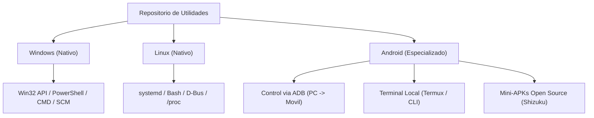
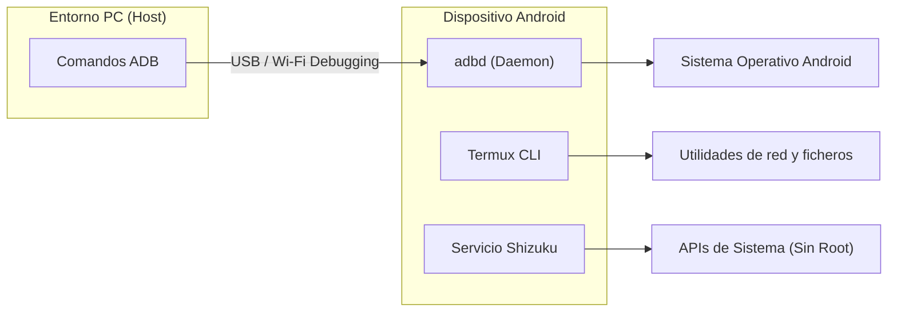

# Utilidades del Sistema Multiplataforma (Windows, Linux, Android)

Dossier tecnico, arquitectura y catalogo de herramientas de administracion de sistemas, automatizacion y control operativo para entornos Windows, Linux y Android.

---

## 1. Vision y Proposito del Proyecto

Este repositorio centraliza utilidades operativas y scripts de sistema orientados a simplificar tareas recurrentes de mantenimiento, gestion de energia, optimizacion y control de dispositivos sin depender de software de terceros de dudosa procedencia ni herramientas con telemetria oculta.

### Principios de Diseno:
* **Transparencia Absoluta (Cero Cajas Negras):** Cada script o binario documenta explicitamente las llamadas al sistema operativo, registros modificados y comandos ejecutados.
* **Principio de Minimo Privilegio:** Ninguna herramienta exige privilegios de Administrador o root a menos que sea estrictamente necesario para la operacion solicitada.
* **Idempotencia y Manejo Defensivo:** Las herramientas deben poder ejecutarse de forma repetida sin generar efectos secundarios no deseados ni estados corruptos.
* **Cero Dependencias Pesadas:** Prioridad a utilidades nativas de cada sistema operativo antes de requerir runtimes externos (como Python o Node.js).

---

## 2. Diagnostico Tecnico y Viabilidad por Plataforma



### Tabla de Evaluacion de Plataformas

| Plataforma | Mecanismo de Ejecucion | Nivel de Privilegios | Viabilidad | Consideraciones Tecnicas |
|---|---|---|---|---|
| **Windows** | PowerShell, CMD, WMI/CIM, Win32 API. | Usuario interactivo / Administrador (UAC). | Total (Alta) | `ExecutionPolicy` en PowerShell; servicios gestionados por el Administrador de Control de Servicios (SCM). |
| **Linux** | Bash (`set -euo pipefail`), `systemd`, D-Bus. | Usuario local (`loginctl`) / `sudo` (Polkit). | Total (Alta) | Variabilidad entre sistemas de init (`systemd` estandar); distincion entre sesiones graficas X11 y Wayland. |
| **Android** | ADB (Android Debug Bridge), scripts en Termux, Shizuku. | Sandbox de aplicacion / Modo depuracion (ADB) / Root opcional. | Segmentada | **Restriccion critica:** Las aplicaciones de usuario no tienen permisos para apagar o reiniciar el dispositivo sin depuracion ADB o privilegios root (`android.permission.REBOOT`). |

---

## 3. Modulo de Referencia Implementado: Temporizador de Apagado

Como primer modulo funcional verificado en produccion (probado en Windows 11 Pro Build 26200), se implemento el mecanismo de apagado programado bajo demanda.

### 3.1. Windows: shutdown.exe

El binario nativo `C:\Windows\System32\shutdown.exe` permite programar el corte de energia sin requerir privilegios elevados de Administrador:

```cmd
shutdown.exe /s /t <segundos>
```

#### Parametros:
* `/s`: Apagado completo de la estacion de trabajo (*shutdown*).
* `/t <segundos>`: Intervalo de espera previo a la ejecucion.
* `/f`: Forzado de cierre de aplicaciones en ejecucion. Se encuentra **activado de forma implicita** si `/t` es mayor a 0.
* `/a`: Aborta de manera inmediata cualquier secuencia de apagado programada que este en cuenta regresiva.

#### Impacto en Servicios y Persistencia:
Al activarse el apagado:
1. Windows emite los mensajes `WM_QUERYENDSESSION` y `WM_ENDSESSION` a los procesos de interfaz de usuario.
2. El Administrador de Control de Servicios (SCM) envia la senal `SERVICE_CONTROL_SHUTDOWN` a los servicios en segundo plano (motores de base de datos como PostgreSQL, MySQL y WSL).
3. Los motores vuelcan buffers pendientes a disco y cierran descriptores de archivo antes de que se desconecte la alimentacion por ACPI.

### 3.2. Equivalente en Linux: systemd y shutdown

En entornos Linux con `systemd`, la operacion se abstrae mediante `loginctl` o `shutdown`:

```bash
# Apagar tras N minutos
shutdown +30 "El equipo se apagara en 30 minutos."

# Cancelar apagado pendiente
shutdown -c
```

Para entornos automatizados sin permisos `sudo`, se utiliza la API D-Bus de `systemd-logind`:
```bash
busctl call org.freedesktop.login1 /org/freedesktop/login1 org.freedesktop.login1.Manager PowerOff b true
```

---

## 4. Estrategia para Android: Mas Alla de los Scripts

Debido a que el modelo de seguridad de Android aisla los procesos dentro de cgroups y un sandbox estricto de SELinux, la integracion en este repositorio se divide en tres vertientes:



### 1. Herramientas Host-to-Device (via ADB):
* **Debloater de Fabricante:** Deshabilitacion de telemetria y paquetes prescindibles de operadoras sin acceso root:
  ```bash
  adb shell pm uninstall -k --user 0 <nombre.del.paquete>
  ```
* **Extraccion y Respaldo:** Script para volcar APKs instaladas y directorios clave a la estacion de trabajo.
* **Control de Dispositivo:** Comandos remotos de reinicio (`adb reboot`), captura de pantalla o envio de texto.

### 2. Entorno Local (Termux):
* Scripts de analisis de red local (escaneo de puertos, diagnostico de latencia).
* Automatizaciones basadas en eventos de red y descargas locales.

### 3. Integracion con Shizuku:
* Acceso a permisos privilegiados a traves del servicio Shizuku para automatizaciones directas en el telefono.

---

## 5. Arquitectura del Repositorio

El proyecto se estructura bajo un esquema de **Monorepo Modular**:

```text
utilidades/
├── README.md                          # Dossier tecnico global (este documento)
├── .gitignore                         # Reglas de exclusion de Git
│
├── windows/                           # Utilidades especificas para Windows
│   ├── power/                         # Gestion de energia
│   │   ├── shutdown-timer.bat         # Interfaz interactiva de apagado
│   │   └── cancel-shutdown.bat        # Cancelacion rapida
│   ├── maintenance/                   # Mantenimiento y limpieza
│   │   ├── flush-dns.bat              # Limpieza de cache DNS y sockets
│   │   └── clean-temp.ps1             # Purgado de archivos temporales
│   └── network/                       # Diagnostico de red
│       └── active-connections.ps1     # Monitor de puertos y PIDs
│
├── linux/                             # Utilidades especificas para Linux
│   ├── power/
│   │   ├── shutdown-timer.sh          # Temporizador para systemd
│   │   └── cancel-shutdown.sh
│   └── maintenance/
│       └── clean-system.sh            # Purga de caches de paquetes (apt/dnf)
│
└── android/                           # Utilidades para Android
    ├── adb/
    │   ├── debloater.sh               # Desinstalador seguro via ADB
    │   └── backup-apks.sh             # Extraccion de paquetes a PC
    └── termux/
        └── network-audit.sh           # Auditoria basica de interfaz
```

---

## 6. Evolucion Futura: Hoja de Ruta

1. **Fase 1 (Actual - Scripts Nativos):** Coleccion inicial de scripts verificados en PowerShell, Batch, Bash y ADB.
2. **Fase 2 (CLI Multiplataforma en Go / Rust):**
   * Desarrollo de un binario unificado (`sysutil` o `toolbox`) que ofrezca un menu TUI interactivo.
   * Compilacion cruzada nativa para Windows (`.exe`), Linux (`ELF`) y Android ARM64 (ejecutable en Termux).
3. **Fase 3 (GUI Ligera Multiplataforma):**
   * Evaluacion de interfaces graficas de bajo peso mediante **Tauri** (Rust) o **Wails** (Go) para evitar la sobrecarga de memoria de frameworks basados en Chromium.

---

## 7. Instrucciones para Publicacion en GitHub

Para vincular este directorio local con tu cuenta remota de GitHub:

```bash
# 1. Crear el repositorio vacio en GitHub (ejemplo: https://github.com/JorgeDoicela/utilidades.git)

# 2. Agregar el origen remoto
git remote add origin https://github.com/JorgeDoicela/utilidades.git

# 3. Establecer la rama principal y enviar los cambios
git branch -M main
git push -u origin main
```
